# Following the schedule

The schedule shows what is dancing now, what is next, and which results are out. It is on the event's **Schedule** tab on the website, and on the competition's **Schedule** tab in the Vote4Dance app. Both update by themselves while the competition runs.

## What the schedule shows

The schedule is split into blocks, each with a start time and a name, such as "11:05 - Juv 1 E2 1/4". Tap a block to see its rounds. Tap a round to see who dances in each heat and, once they are out, the results.

The dot after a block tells you where it stands:

- **Red**: a round in the block is dancing now.
- **Orange** (yellow in the app): some of the block's results are out, and some are still to come.
- **Green**: all results in the block are out.
- **Grey**: the block has not started.

When the event has more than one day, pick the day at the top. The schedule opens on today.

## Find your club's rounds

When you follow a whole club, the schedule picks out the rounds its dancers are in. Team leaders and coaches use this to see when their dancers are on during the day. You can also follow single dancers. Following needs a Vote4Dance account with Premium.

On the website:

1. Sign in and open the event.
2. Open the **Competitors** tab and unfold **Organizations**, under the search field. It lists every club with dancers at the event.
3. Click the heart next to your club. Do the same for any other club you want to follow. The number next to **Organizations** shows how many you follow.

   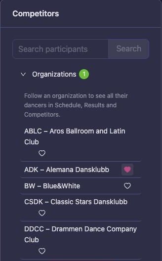

4. Open the **Schedule** tab and pick **Favorites** above the schedule. The schedule becomes your timetable for the day. **Following** at the top names what you follow and how many rounds they are in; **Change** takes you back to **Organizations**.

   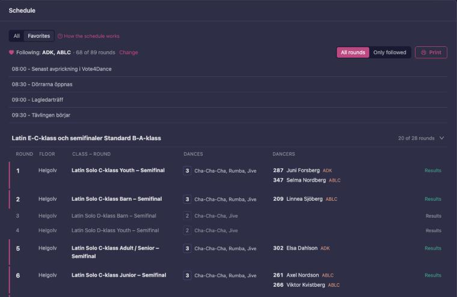

What the timetable shows:

- Every round with dancers you follow lists them under the round: start number, name and club. A group or formation shows its team name and start number. A round with many of your entries shows the first six; click **+ more** to see the rest.
- Each round shows its number, floor, class, round (such as **Semifinal**), and the number and names of its dances. The time is shown when the organizer publishes times.
- Your dancers are named at their class's first round. A later round of the class says **if through from round** and the round number until that round is done. Then it lists who got through, or says **None through**.
- The other rounds stay in the list, greyed out, so you can see how much is danced in between. Pick **Only followed** to fold them away: a short row then says how many rounds are in between and lists them. **All rounds** shows them again.

### Print the timetable

To take the timetable on paper or as a PDF, for example to the team leaders' meeting:

1. Pick **Favorites** on the **Schedule** tab, and **All rounds** or **Only followed**.
2. When the event has more than one day, pick the day. You print one day at a time.
3. Click **Print** (**Print day** on an event with several days). Your browser's print window opens; choose a printer, or **Save as PDF**.

The printout lists the event, the day, what you follow and when you printed it, then each block of the schedule as a table with round, floor, class, dances and your dancers.

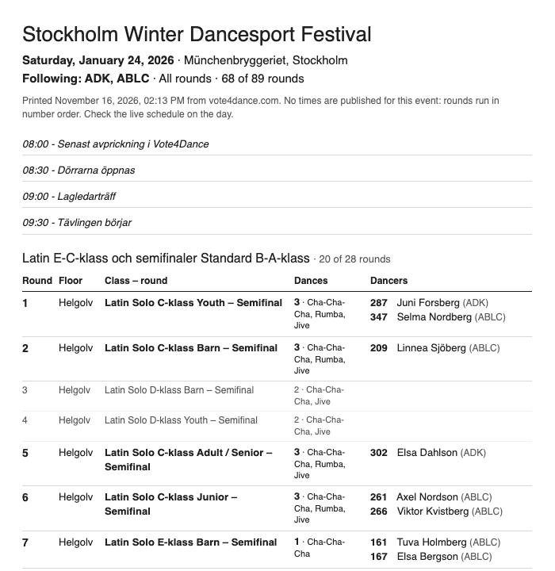

The schedule can change on the day, with late withdrawals or rounds run ahead of plan, so check the live schedule at the event.

In the app:

1. Open the competition and the **Competitors** tab.
2. Unfold **Organizations at this event** and tap the heart next to your club.
3. Open the **Schedule** tab and pick **Favorites**. The app marks the same rounds with a heart; open a round to see who dances. Printing is done on the website.

### List your club's entries

The **Competitors** tab has a **Favorites** switch too. With **Classes** picked it lists only the classes your club's dancers are in; click a class to see your dancers' heats. Pick **List** for a short list of everyone you follow, for example to hand out at the team leaders' meeting:

1. Open the **Competitors** tab, pick **Favorites** and then **List**.
2. Each row is one start number: the dancers, their club and every class they are entered in, with the round each class starts in. A group or formation shows its team name.
3. Pick **By start no.** to sort by start number, or **By club** to see each club's entries under its own heading.
4. Click **Print** to print the list or save it as a PDF. In the print window you choose **Portrait** or **Landscape**.

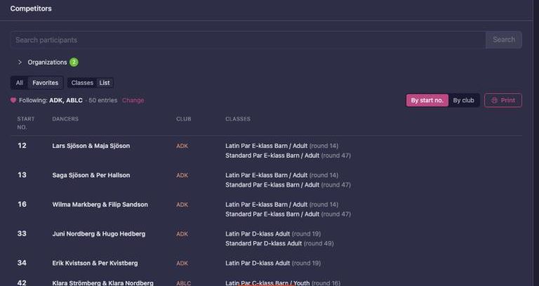

A link to the list opens it directly, so you can share it with other team leaders who follow the same clubs.

### Download a club's entries as a spreadsheet

You don't need Premium for this. On the **Competitors** tab, unfold **Organizations** and click a club's name. **Showing** and the club then appear next to **All** and **Favorites**, with **Download CSV**. The file opens in Excel and lists the club's entries class by class, with each entry's start number, name and heat in every round.

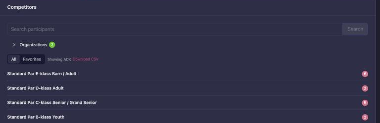

You follow a club for one event at a time, so follow it again at the next event. The app's **Favorites** tab collects what you follow, grouped by competition: see [Follow dancers and clubs with Premium](/dancer/following-in-the-app/#follow-dancers-and-clubs-with-premium).

Without Premium, the heart, **Favorites**, the list and printing open the Premium offer instead. The club's CSV download works without Premium. When you are not signed in, the heart cannot be clicked.

To see which of your club's dancers are entered, and download the list, open the club's **Administration → Registration**: see [Registration](/school-club/club-admin/#registration).

## Times on your phone

Each round shows the time it is planned to start, so you know when to be in the hall. On a phone held upright the website shows the time where the block number used to be. You no longer need to turn the phone sideways to see it. The app shows both the time and the block number.

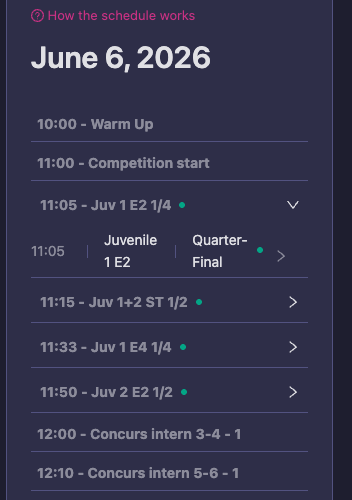

*Finished blocks are grey and keep their green dot.*

Planned times move when the competition runs ahead or behind. When the organizer has chosen not to show times, you see the block number instead.

## Battle results as a tree

When a class is run as battles, its result is easier to follow as a tree than as tables. Open the event page, go to **Results** and pick the class. At the top you choose **Tree** or **Tables**. **Tree** is shown first.

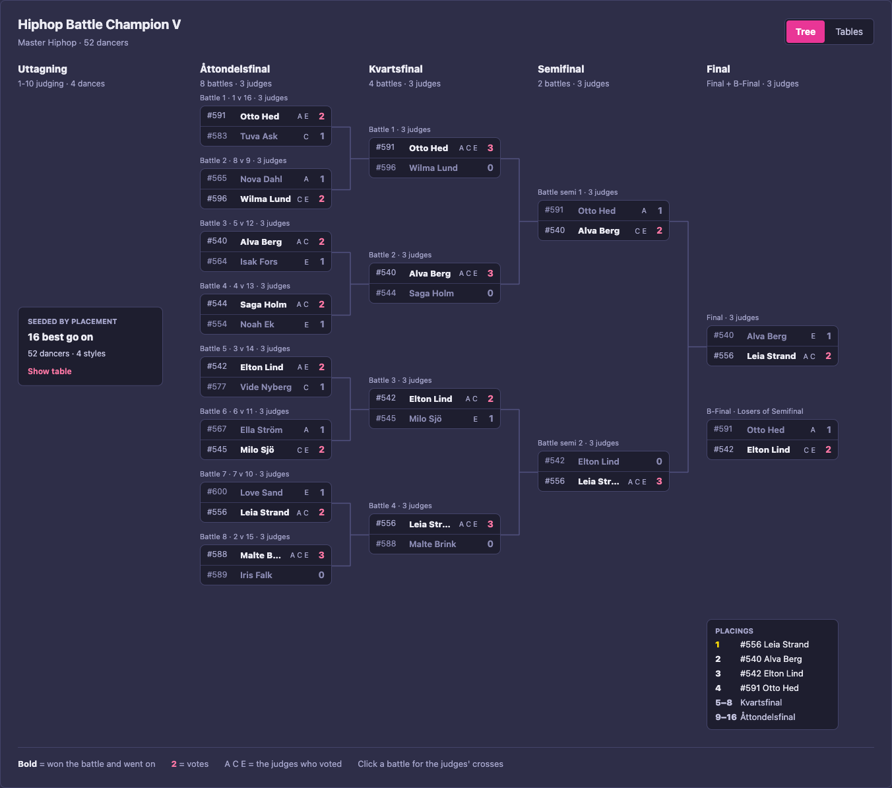

The tree reads from left to right:

- First comes the selection round, with how many dancers go on.
- Then one column for each battle round, for example eighth-final, quarter-final, semifinal and final.
- Each battle is a box with the start number and name of both dancers, the letters of the judges who voted for each of them, and the number of votes.
- The winner is in **bold** and the loser is dimmed. A line leads from each battle to the battle its winner goes to next.
- The B-final hangs under the final.
- A **Placings** box lists 1st to 4th by name, then ranges such as 5-8 and 9-16.
- When a battle is won over several rounds, for example best of 3 or best of 2 with a tie-break, the number is the rounds won instead of the votes, and each dancer has a dot per round: filled for a round they won, a ring for a round they lost, an orange ring for a round that ended level, and a dash for a round not danced yet.

The seed of a dancer, for example "1 v 16", is shown once the selection round has been published.

To see the tables behind a battle, click the battle, or press **Show table** to open the tables for the whole round. Choose **Tables** at any time to go back to the tables.

On a phone the tree shows one round at a time:

1. Pick a round with the round buttons at the top, or move between rounds with the arrows on either side of the round's name.
2. Under each battle you see where its winner goes next, for example "Winner → Semifinal battle 2".

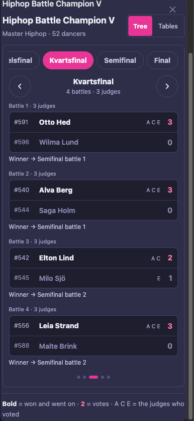

Only rounds that have been published show results. When the organizer hides or delays the judges' marks, for the whole event or for one round, the tree shows no votes and no judge letters, only who went on. Places the organizer hides are not shown either.

### In the Vote4Dance app

In the app, open the competition's **Results**, tap the class, and the result sheet opens on **Tree**, with **Tables** next to it. It works like the website on a phone: pick a round with the round buttons or the arrows, and each battle shows both dancers with their start number and name, the judges who voted for each, and the votes. The winner has a pink start number and is in bold, and under each battle you see where the winner goes next. The last page has the final, the B-final and the placings.

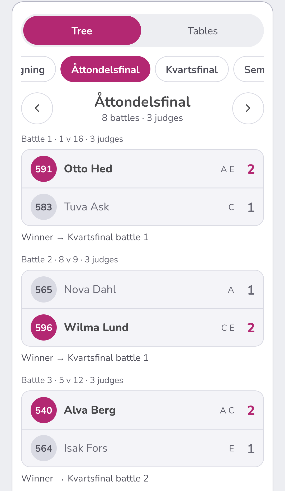

A battle won over several rounds shows the rounds won and a dot per round, as on the website. In the picture below, battle 1 went to a tie-break: Noor Lindqvist won the first round and the tie-break, Ella Sandberg the second.

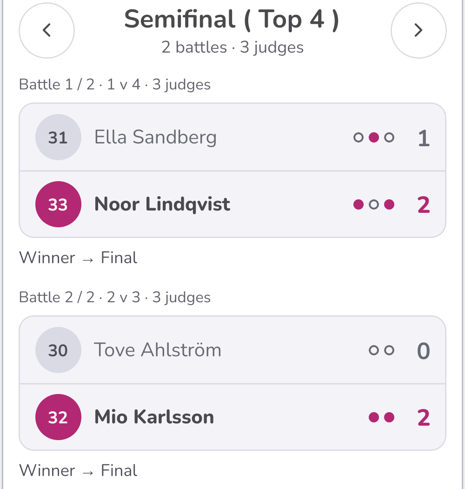

## Finished blocks turn grey

Blocks whose results are all out turn grey, and so do the notes above the block that is dancing now, such as "Competition start" or a lunch break. The block that is dancing, and everything after it, stays bright, so you find your place in a long schedule at a glance. The green dot stays, so you can still see which results are out.

## Earlier blocks fold away

Once a day is under way, finished blocks you have already passed are folded away, so the schedule opens near what is dancing now. The two most recent finished blocks stay, so their results are one tap away.

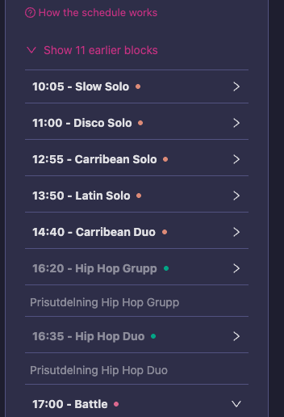

*Blocks still waiting for results stay at the top. Then come the two most recent finished blocks, in grey, and the block that is dancing now.*

The app works the same way:

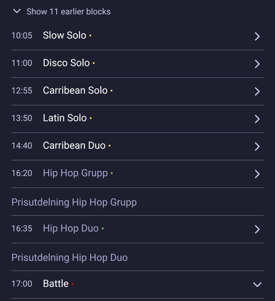

To see the whole day:

1. Scroll to the top of the schedule.
2. Tap **Show earlier blocks**. The number in the link tells you how many blocks are folded away.
3. Tap **Hide earlier blocks** to fold them again.

Your choice is remembered for that event on your phone or computer. If you showed the earlier blocks, they stay shown the next time you open the schedule.

Good to know:

- A block that is still waiting for some of its results never folds away, even when later blocks have finished. You can always find it while you wait.
- Nothing folds away on a day that has not started, or on a day where every block is finished.
- Blocks do not disappear while you are reading. A block that finishes turns grey straight away, and folds away the next time you open the schedule or come back to it.
