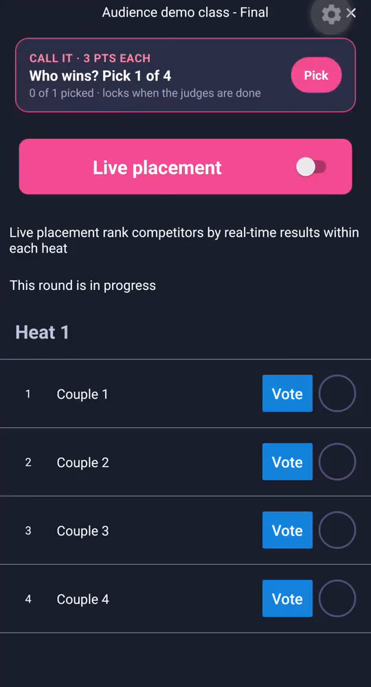
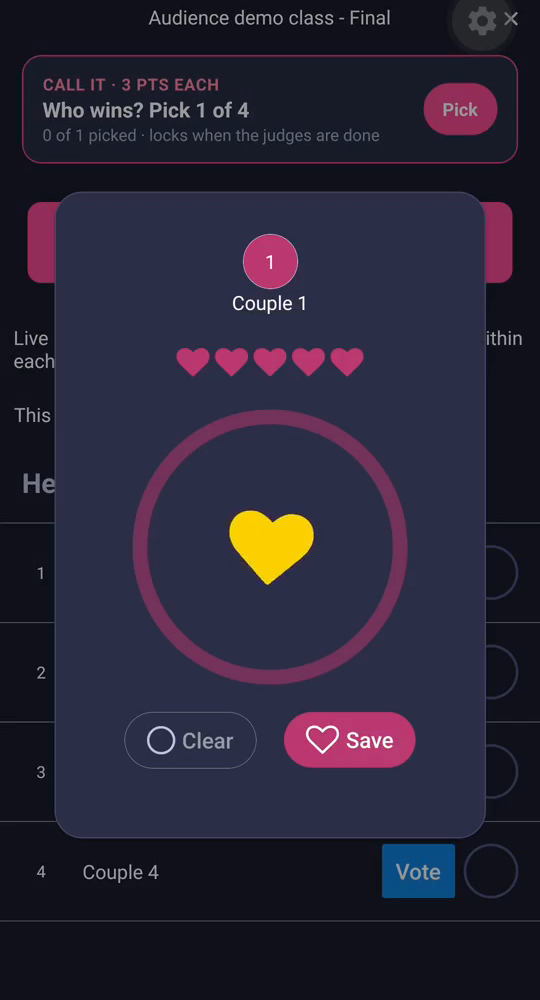
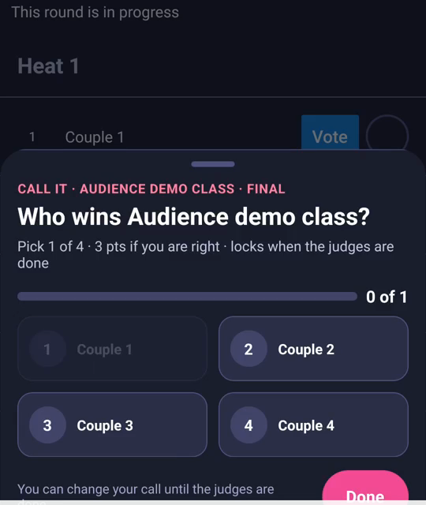
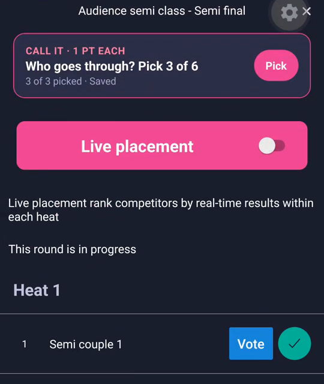
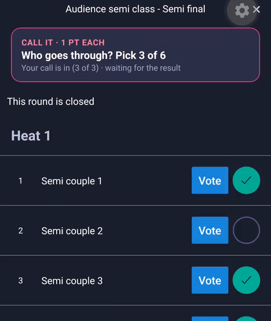
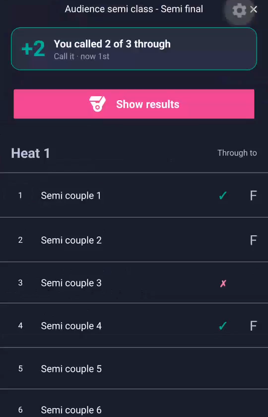
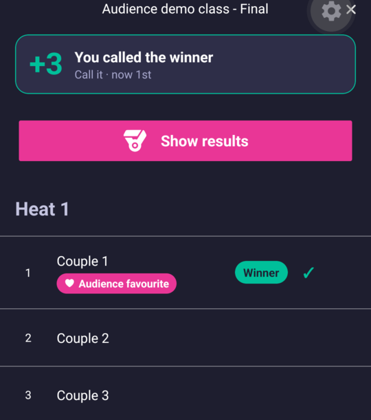

# Hearts and Call it

While a round is on the floor you can take part from your seat, in the Vote4Dance app: give hearts to the couples you like, and call who you think goes through or wins. Both are free, you need to be signed in, and neither changes the judges' results.

## Give hearts

Hearts are open while a round is on the floor, and close when the judges are done. If the organizer has not switched voting off for the event, you find **Vote** next to the couples in a heat.

1. Open the event in the app and open the heat on the floor.
2. Tap **Vote** next to a couple. The hearts card opens.
3. Press and **hold** the big heart. The ring fills while your finger is down; each time it is full you earn a heart. Lift your finger and it stops where it is.
4. Tap **Clear** to start over, or **Save** to give your hearts.

The heat shows how many people have voted, for example "143 have voted". After the round is published, the couple the room liked most is shown as the **Audience favourite** on the results.

On the website the heat only shows a card, **Give hearts in the Vote4Dance app**, with an **Open in the app** button. Hearts are given in the app and are not shown on the web.

If the organizer shows the hearts live, the ranking of the round is on screen in the hall and, with Premium, on your phone while the round is danced (**Live hearts · Premium**). Otherwise you see the result once the round is published.

## Call it

**Call it** is a game of picking who wins. There is nothing to set up: every competition day of an event has its own game, **Call it** with the day's name, for example **Call it · Saturday 7 Nov**. It opens at 18:00 the evening before and ends when the day's last final is published.

Open the event in the app and tap the **Call it** card, **Call the finals of the day**. The day's game has three parts:

- **Your finals**: the finals with your own couples, your club or the couples you follow. Follow a couple or a club to see their finals here.
- **Headline finals**: the day's biggest finals.
- **The day in numbers**: a few questions about the day, such as how many dancers or clubs take part and how many finals are danced. They are answered from Vote4Dance's own numbers when the game ends; the closest answer wins.

You call who wins each final. A final that comes straight after the first round can be called as soon as the game opens. A final after a semi-final opens when the semi-final's results are published, because only then is it known who dances in it. Every final can also be called from its heat.

Rounds before the final can be called too, from the heat, while they are on the floor:

- In a **semi-final or other round that sends couples on**, you pick as many couples as go through. The heat card says, for example, **Who goes through? Pick 3 of 3**.
- In a **final**, you pick the winner: **Who wins? Pick 1 of 4**.
- You earn points for every couple you called right, and a bonus if you called all of them. The sheet tells you the points before you pick, for example "2 pts per correct couple". A final is worth more than a semi-final.
- You cannot call your own team.

To make a call:

1. Open the heat. Next to **Vote** you see **Call it**; the card shows how many you have picked, for example "1 of 3 picked".
2. Tap **Pick** (or the circles on the couples) and choose couples. Tap **Done**.
3. Tap **Done**, or **Send my call** if the sheet shows it. The card then says **Saved**.

You can change your call until the round starts, or until the judges are done. The card tells you which: "locks when the round starts" or "locks when the judges are done". After that it says that your call is in and waiting for the result.

When the results are published the couples are marked **Through** or **Not through** (a final: **Winner**), and your card tells you how you did, for example "You called 2 of 3 through", with a ✓ or ✗ for each of your picks. Your points go on the standings of that day's **Call it**, which you find with the quizzes on the event page.

In a final the winner is marked **Winner**, and the couple the room liked most **Audience favourite**.

## What is free

| | Free | Premium |
|---|---|---|
| Hearts | Give hearts, see how many have voted, the audience favourite after the round | The live hearts ranking during the round, where the organizer shows it |
| Call it | Call every round, see your points and your standing | |

Taking part is free; Premium follows the event more closely. See also [Quizzes](/spectator/quizzes/) and [The Audience page](/spectator/audience-page/).
