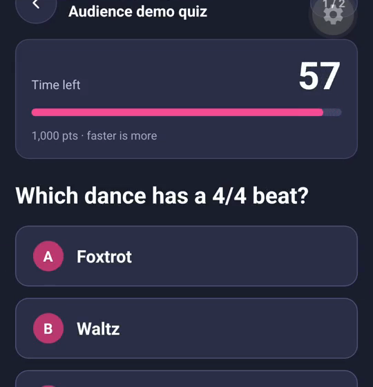
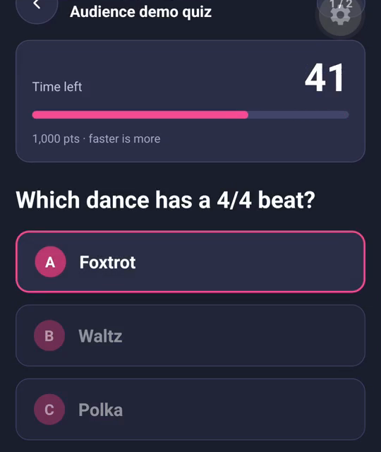
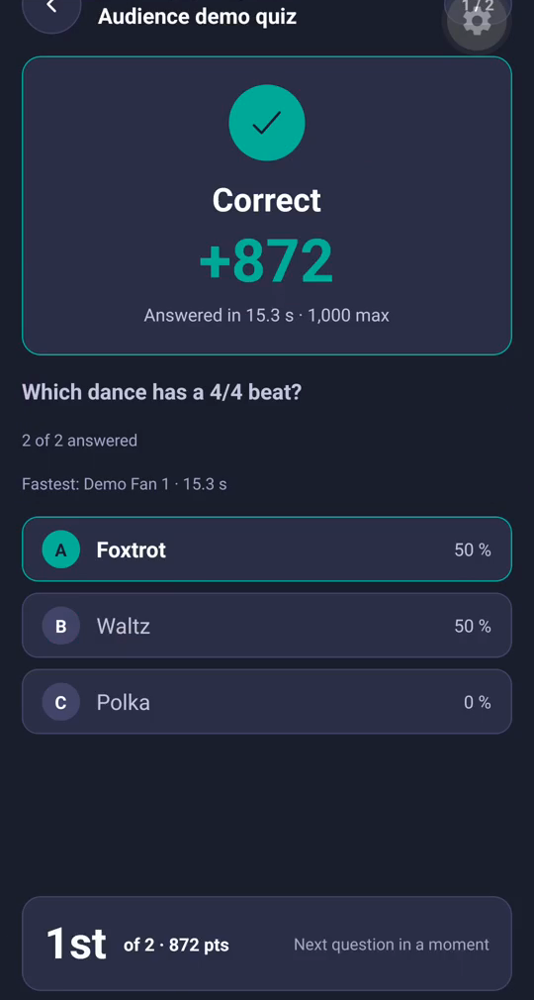
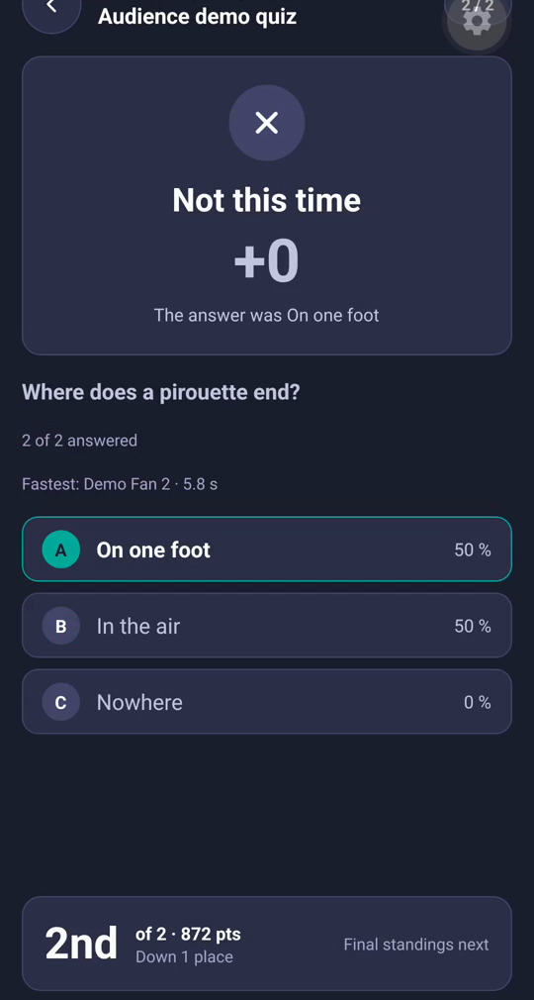
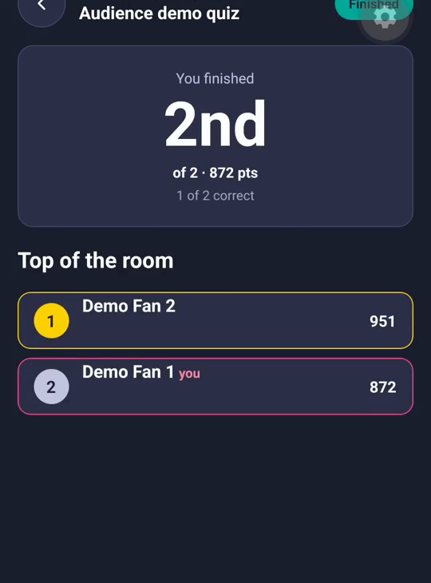
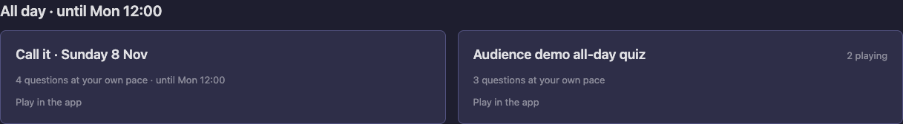
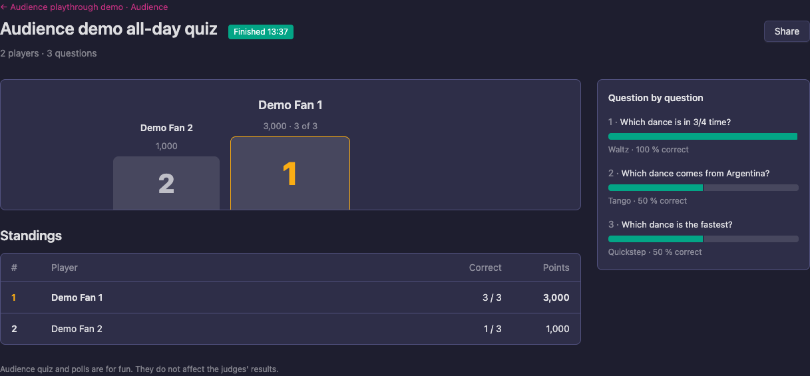
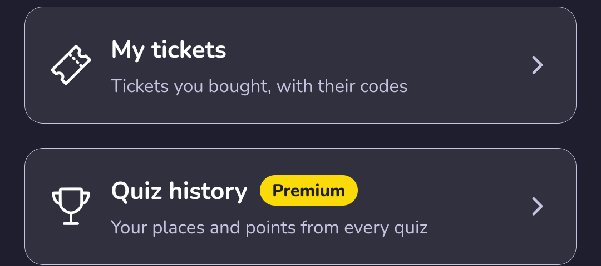
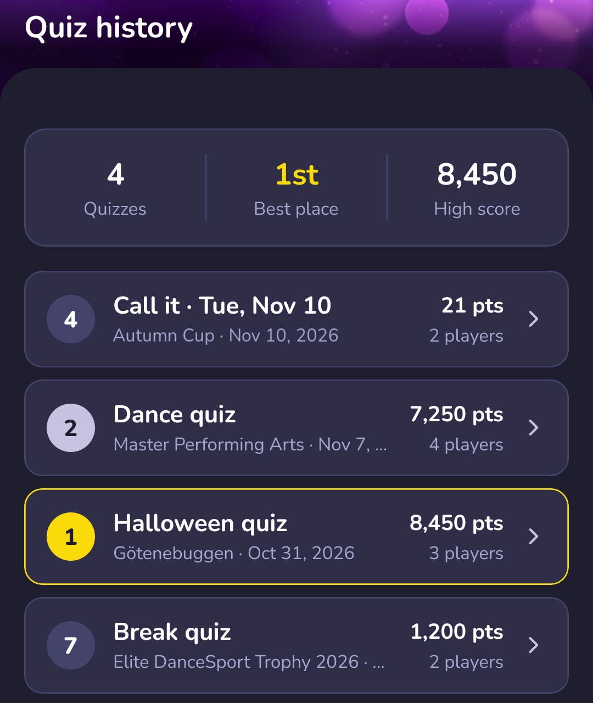
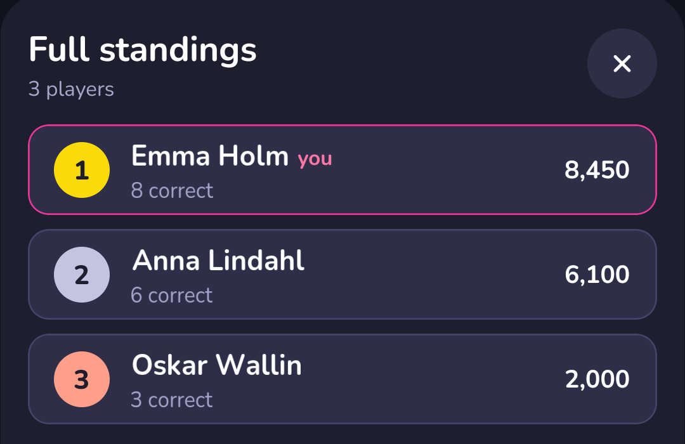

# Quizzes

The organizer can run quizzes at the event: one live in the hall, with the questions on the big screen, and quizzes you play during the day on your own phone. Play in the Vote4Dance app, signed in. It is free, and a quiz never changes the judges' results.

When a quiz is on, the event page in the app shows a **Quiz is on** card with how many are playing and a **Join** button.

## The live quiz

The speaker runs the live quiz from the hall, one question at a time.

1. Scan the QR code on the screen ("Scan to join"), or open the event in the app and tap **Join** on the **Quiz is on** card. Sign in if you are asked.
2. Check the name shown ("You play as"). It is your account name and appears on the leaderboard. Tap **Join the quiz**.
3. You are in: **You're in**, with a note that the first question opens in a moment.
4. When a question opens, the same question is on the screen. Tap your answer before the clock runs out. You get one answer per question and cannot change it. A correct answer earns points, and in most quizzes the faster you are, the more you earn ("faster is more").

5. When the question closes you see the reveal: **Correct**, **Not this time** or **No answer**, the right answer, your points and whether you moved up or down.

6. After the last question you see how you finished and your place in the top of the room.

If your phone loses the network or you reload, you land back on the current question.

## All-day quizzes

An all-day quiz is open for hours, for example until the finals. Nobody runs it; you play whenever you like. On the event's [Audience page](/spectator/audience-page/) on the web, it is under **All day**, with how many questions you play at your own pace and how many are playing.

1. Open the quiz from the event page.
2. Answer the questions in any order. Your progress and your place at the moment are at the top.
3. Until the quiz closes you can change your answers: "You can change your answer until the quiz closes".
4. When the quiz closes, the right answers and your points show for each question.

Some questions are predictions about a round on the floor, such as who wins. They open when the round is on the floor and lock when the round starts or when the judges are done; the question says which.

A **play-now** quiz has a timer on each question. The clock starts when you open the question, and you have a few seconds to answer once.

## Standings

During and after a quiz you see your own place and points. The top 10 is open to everyone. The full standings, beyond the top 10, are part of Premium. The podium and the final standings are also on the event's [Audience page](/spectator/audience-page/) on the web: click **Standings →** next to a finished quiz for its results page, with the podium, each player's correct answers and points, and for each question the right answer and how many got it right.

## Your quiz history

**Quiz history** in the app keeps every quiz you have played, so you can look back on how you did after the event. It is part of Premium.

1. Open the **Profile** tab and tap **Quiz history** ("Your places and points from every quiz"), under **My tickets**.

   

2. At the top are three numbers: **Quizzes**, how many you have played; **Best place**, your best finish; and **High score**, the most points you got in one quiz.
3. Below them is one row for each quiz, newest first: your place, the name of the quiz, the event and its date, your points and how many played. A place on the podium has a gold, silver or bronze badge, and a quiz you won has a gold frame. Your **Call it** days are listed too, by their day.

   

4. Tap a quiz to see its **Full standings**: every player with their place, how many they got right and their points. Your own row is marked **you**. Tap the **×** to close it.

   

A quiz shows up in your history once it has closed. Until you have played one, the screen says "No quizzes yet. Join a quiz at an event and it shows up here when it has finished."

If you don't have Premium, the card shows a **Premium** label, and tapping it opens the Premium offer instead. See [Follow dancers and clubs with Premium](/dancer/following-in-the-app/#follow-dancers-and-clubs-with-premium).

## Free and Premium

Playing every quiz is free: join, answer, see your points and rank, the top 10 and the podium. Premium adds the full standings beyond the top 10 and your [quiz history](#your-quiz-history).

The organizer sets up the quizzes before the event. See also [Hearts and Call it](/spectator/hearts-and-calls/).
