# Signing in

You sign in to Vote4Dance with your e-mail address. There is no password to remember: Vote4Dance sends a short code to your e-mail, and you type it in. (If your account has a password from before, you can use that instead, see [Use your password](#use-your-password).) If you like, you can then save a **passkey** on your phone or computer, so that your face, fingerprint or phone code signs you in next time.

This is the same for everybody: dancers, parents, judges, organizers, desk staff, club administrators and spectators. All the Vote4Dance web apps share one sign-in, so you sign in once and are signed in everywhere on that device.

**The Vote4Dance mobile app signs you in the same way.** It uses the same e-mail address, the same code and the same passkeys, so what you set up on the website works in the app too. Where the app differs, a short note says so.

## Sign in with a code

Use this the first time, on a new device, or whenever you have no passkey.

1. Go to [vote4dance.com](https://vote4dance.com) and choose **Sign in**.
2. Type your e-mail address and press **Continue**.

   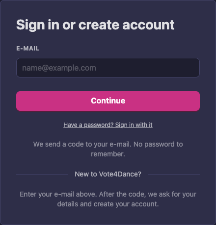

   On a phone the screen is shorter: it leaves out **Use a passkey from your phone** and the box about borrowed or shared computers, since you are already on your phone.

   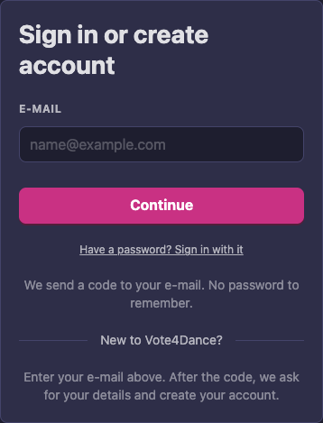

3. Open your e-mail. Vote4Dance has sent you a 6-digit code. It works for 10 minutes. On a phone, Mail often offers the code above the keyboard, so you only tap it. The code is also in the subject line of the e-mail, so you can read it in the notification without opening the e-mail.
4. Type the code and press **Continue**.

   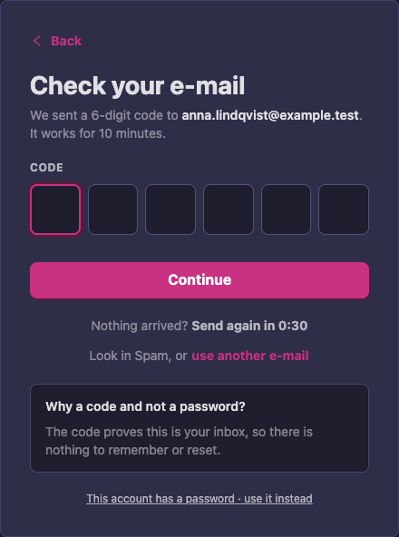

If the code is late, press **Send again** after 30 seconds. The code in the first e-mail keeps working for 10 minutes, so it is not wasted if that e-mail turns up late. Use whichever code you have: either one signs you in, and then both stop working.

You are signed in. The code proves that the inbox is yours, so there is nothing to remember and nothing to reset.

**In the app.** Open the Vote4Dance app and choose **Sign in** (or **Join Vote4Dance** if you are new). Type your e-mail address, press **Continue**, and type the 6-digit code on the **Check your e-mail** screen; the code is in the e-mail's subject line, so the notification already shows it. The screen has **Send again** and **use another e-mail** if the code does not arrive. The button under the code says **Continue**, and after **Send again** the first code still works too.

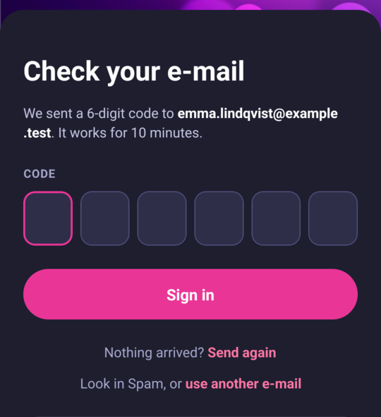

## Create an account

You do not need a separate step to sign up. Use the same screen as for signing in.

1. Go to [vote4dance.com](https://vote4dance.com), type the e-mail address you want to use and press **Continue**. Use an address of your own that you will keep: it is your sign-in name, and registration confirmations and your check-in QR code are sent to it.
2. Type the 6-digit code that Vote4Dance mails to that address.
3. Because the address is new, a short form follows. Fill in **Firstname**, **Lastname** and **Nationality**, and tick **I accept the Terms of Service and Privacy Policy**. (In the app the form is called **Create your account** and asks for **First name**, **Last name** and **Country**.)

   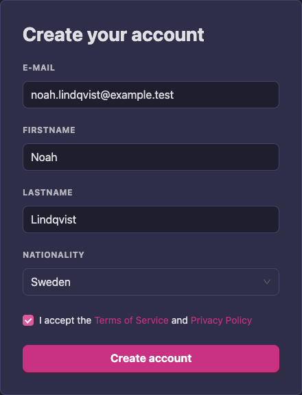

4. Press **Create account**.

In the app, choose **Join Vote4Dance** on the first screen; the steps are the same. There is no password to invent. Use the name your federation and organizers know you by, not a nickname: it is how you are found in entry lists. What to do next, for example filling in your profile and joining a club, is described for each role, for example [Dancer account creation](/dancer/account-creation/).

**One account per person.** If you already have an account, use the same e-mail address and you are signed in to it. Do not create a second account with another address: your results, licences and registrations would be split across two accounts. Children need their own accounts too, see [Children's accounts on a parent's phone](#childrens-accounts-on-a-parents-phone).

**Accounts made for you at the check-in desk.** When the desk creates an account for you on the spot, it does not get a password. You sign in with your e-mail address and a code, exactly as above.

## Use your password

If your account has a password from before, you can keep using it.

There are two ways to the password screen.

**From the first screen.**

1. Type your e-mail address.
2. Under **Continue**, choose **Have a password? Sign in with it**. The password screen opens with your e-mail address already filled in.
3. Type your password and press **Sign in**.

If you chose it by mistake, press **Back** to return to the e-mail screen.

**From the code screen.**

1. Type your e-mail address and press **Continue**.
2. On the screen that asks for the code, choose **This account has a password · use it instead**.
3. Type your password and press **Sign in**.

   The app has the same two ways: choose **Have a password? Sign in with it** under **Continue** on the first screen, or **This account has a password · use it instead** under the code. Then type your e-mail address and password, and press **Sign in**. If the app cannot send a code, for example because of a problem with the connection, the screen says what went wrong and offers the same link, so you can sign in with your password instead.

   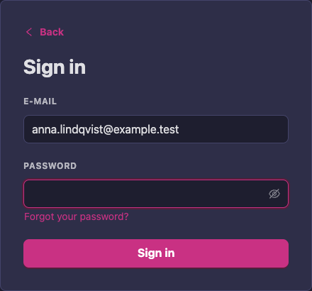

If you have forgotten your password, choose **Forgot your password?** on this screen (in the app it is **Forgot password?**). Vote4Dance mails you a link to set a new one. You do not have to: the e-mail code always works too.

If you change your password, Vote4Dance signs your account out on your other devices. Sign in again there with a code or your new password.

## Save a passkey

A passkey lets your face, fingerprint or the code you use to unlock your phone sign you in. It is safer than a password, and quicker than a code.

After you sign in with a code or a password, on a device that supports passkeys, Vote4Dance offers to save one. It asks once on each device.

1. On **Sign in faster next time**, choose **Save passkey for** followed by your name.

   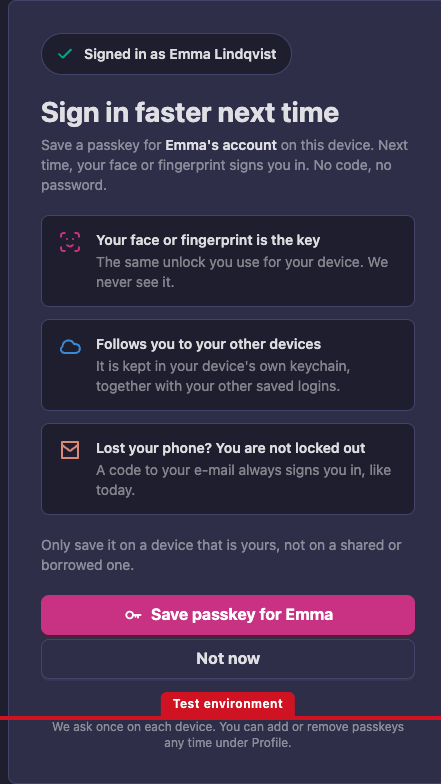

   Only save it on a device that is yours, not on a shared or borrowed one.

2. Confirm with your face, fingerprint or phone code when the phone or computer asks.
3. A screen says **Passkey saved** and shows which device it is saved on. Press **Continue**.

   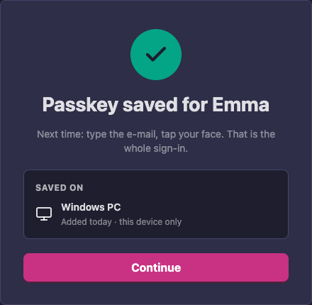

If you do not want one now, choose **Not now**, the button next to the save button. You can add one at any time, see [Manage how you sign in](#manage-how-you-sign-in).

Good to know:

- **Vote4Dance never sees your face or fingerprint.** Your phone checks it, exactly as when you unlock the phone, and tells Vote4Dance only that the check passed.
- **A passkey only works on vote4dance.com**, so a fake website cannot trick it out of you.
- **On iPhone and Android it follows you.** It is kept in your device's own keychain, together with your other saved logins, so it is also on your new phone. On other devices it can be for that device only; the list under **How you sign in** says which.
- **You are not locked out if you lose your phone.** A code to your e-mail always signs you in.
- **Changing or resetting your password removes your passkeys.** That signs out anyone who might have saved one with your old password. Save a new passkey on your own devices afterwards.

**In the app.** Right after you sign in, the app shows the same **Sign in faster next time** screen. Choose **Save passkey for** followed by your name and confirm with your face, fingerprint or phone code, or choose **Not now**, the outlined button. It asks once on each phone.

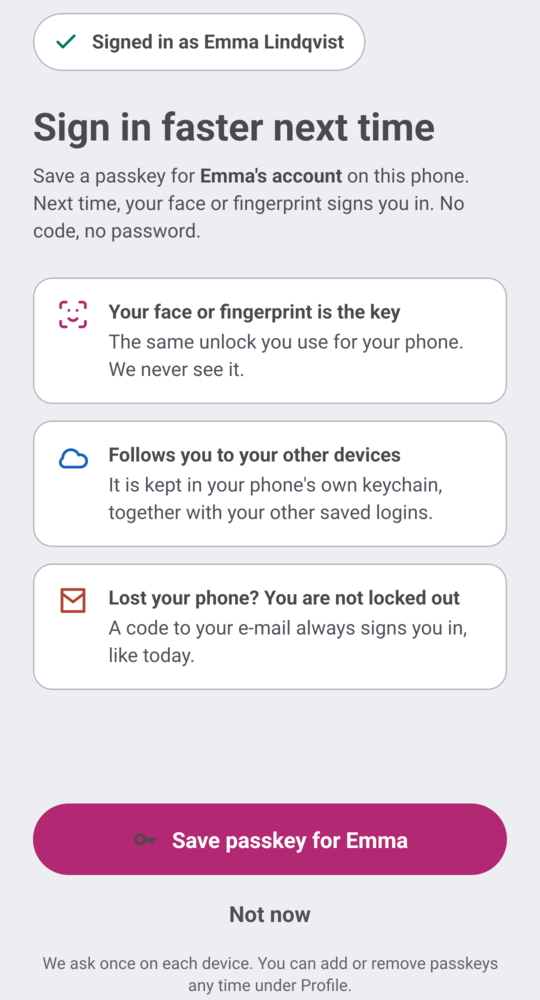

To read more about passkeys, choose **What is a passkey?** on the sign-in screen.

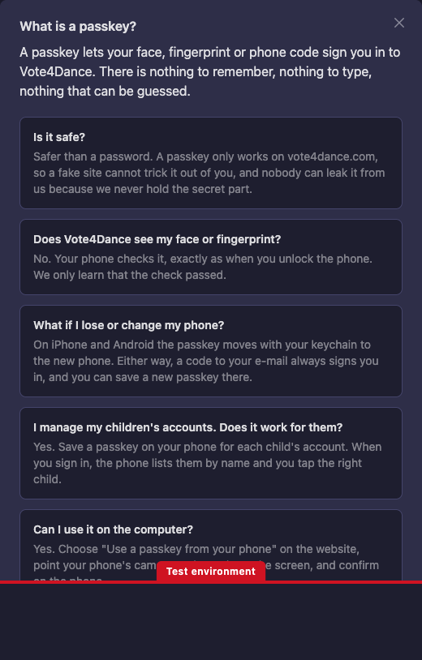

## Sign in with a passkey

Once a passkey is saved, signing in takes a few seconds.

1. Go to [vote4dance.com](https://vote4dance.com) and choose **Sign in**.
2. Tap in the e-mail field. Your device offers your passkey.
3. Choose it and confirm with your face, fingerprint or phone code.

You are signed in, with no code and no password.

**In the app.** On the first screen choose **Sign in**, then choose **Use a passkey** below **Continue** and confirm with your face, fingerprint or phone code. The passkey has to be saved on that phone first.

### On a borrowed or shared computer

You can use the passkey on your phone to sign in on a computer that is not yours. Nothing is saved on that computer. This choice is shown on computers and tablets, not on phones.

1. On the computer, go to [vote4dance.com](https://vote4dance.com) and choose **Sign in**.
2. Choose **Use a passkey from your phone**.
3. A code appears on the screen. Point your phone's camera at it and confirm on the phone.

If you have no phone with you, use the e-mail code instead.

## Children's accounts on a parent's phone

Every dancer has an account of their own, and a child's account has its own e-mail address (see [Dancer account creation](/dancer/account-creation/#one-account-per-dancer)). If you manage your children's accounts, you can save a passkey for each child on your own phone.

1. Sign in to your child's account with its e-mail address. The code goes to that address, which is often your own.
2. When Vote4Dance offers a passkey, check that it says your child's name, for example **Save passkey for** followed by the name, and choose it.
3. Repeat for each child.

Next time, the phone lists the accounts by the child's name. Tap the right child and confirm with your face or fingerprint.

## Manage how you sign in

You can see and change your passkeys in your profile.

1. Sign in, open your name at the top right and choose **My account**, then **Settings**.
2. Find the box **How you sign in**.

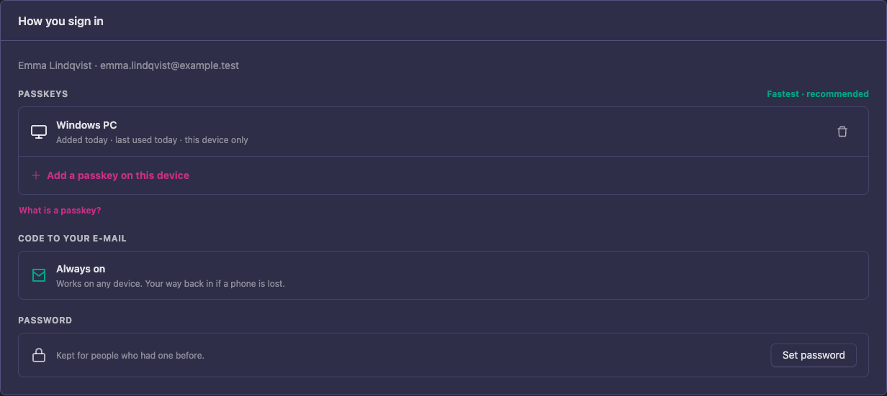

It has three parts:

- **Passkeys** lists the passkeys you have saved, when each was added and last used, and whether it is shared with your other devices or on this device only.
  - To add one for the device you are on, choose **Add a passkey on this device**.
  - To remove one, choose the bin at the end of its row and confirm. That passkey will no longer sign you in. A code to your e-mail still works.
- **Code to your e-mail** is marked **Always on**. It works on any device and is your way back in if a phone is lost.
- **Password** has **Set password**, for people who want a password too or had one before.

**In the app.** Open the **Profile** tab, choose **Settings**, then **How you sign in**. It shows the same **Passkeys** list with **Add a passkey on this device**, and **Code to your e-mail**, marked **Always on**. To remove a passkey, choose the bin icon at the end of its row and confirm with **Remove**. Setting or changing a password is done on the website.

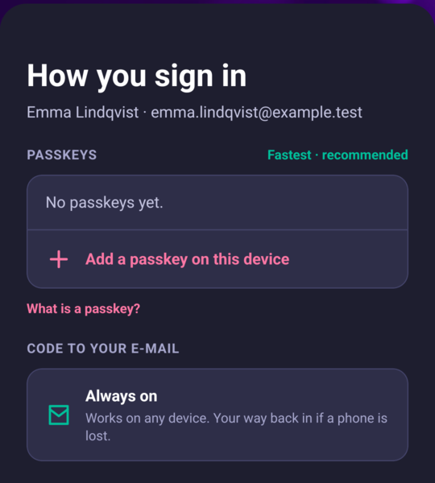

## If something goes wrong

**The code does not arrive.**
- It can take a minute. Look in **Spam** or junk mail.
- After 30 seconds the screen offers **Send again**. Use it once. The code in the first e-mail still works for 10 minutes, so if it arrives late you can use it; either code signs you in.
- Check that the address is spelled right. If it is not, choose **use another e-mail** (or **Back**) and type it again.

**"This code is invalid or has expired."** A code works for 10 minutes. Ask for a new one with **Send again**, and type the newest.

**"Too many attempts."** If you try too many times in a short while, Vote4Dance makes you wait. The message says how many seconds. Wait, then try again with the newest code.

**You lost or changed your phone.** Sign in with a code to your e-mail. If you use iPhone or Android, your passkey is probably on the new phone already. Otherwise, save a new one after signing in, and remove the old one under [How you sign in](#manage-how-you-sign-in).

**The device does not offer a passkey.** Not every browser or device supports them. Sign in with a code. Nothing else is lost.

**"This account has been disabled."** Contact Vote4Dance support.
